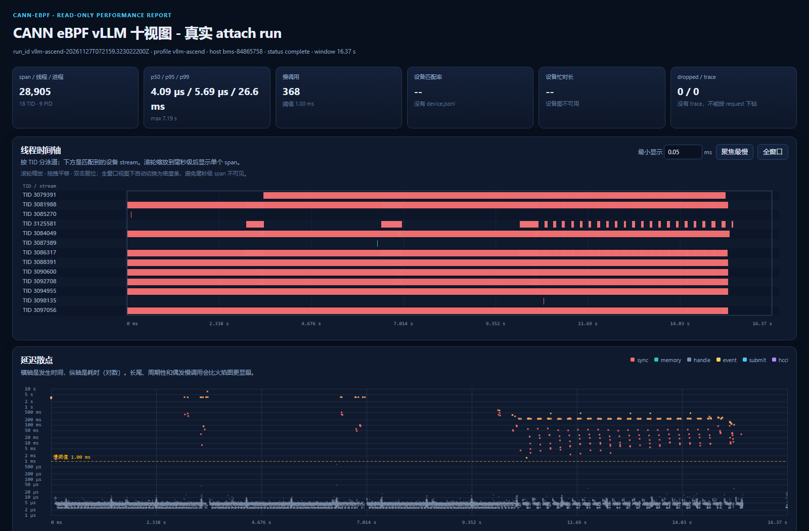
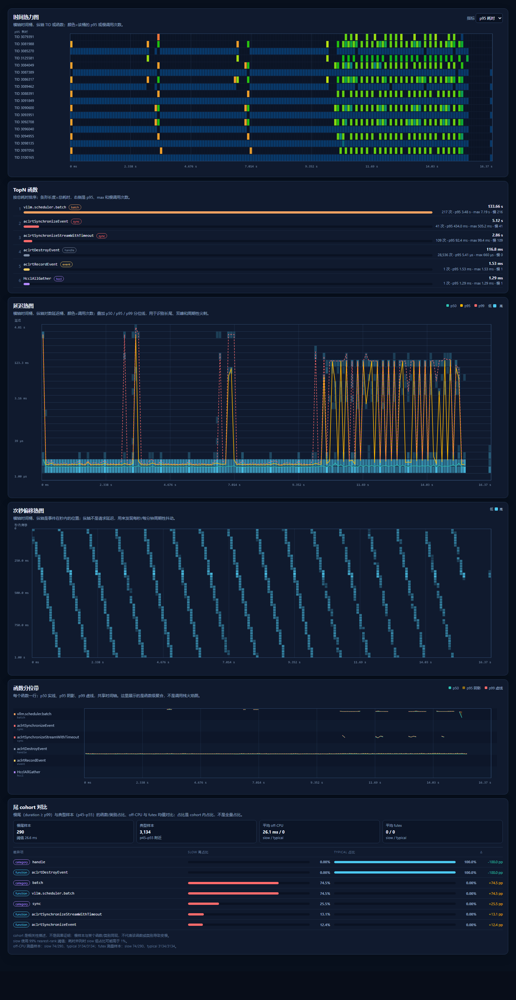
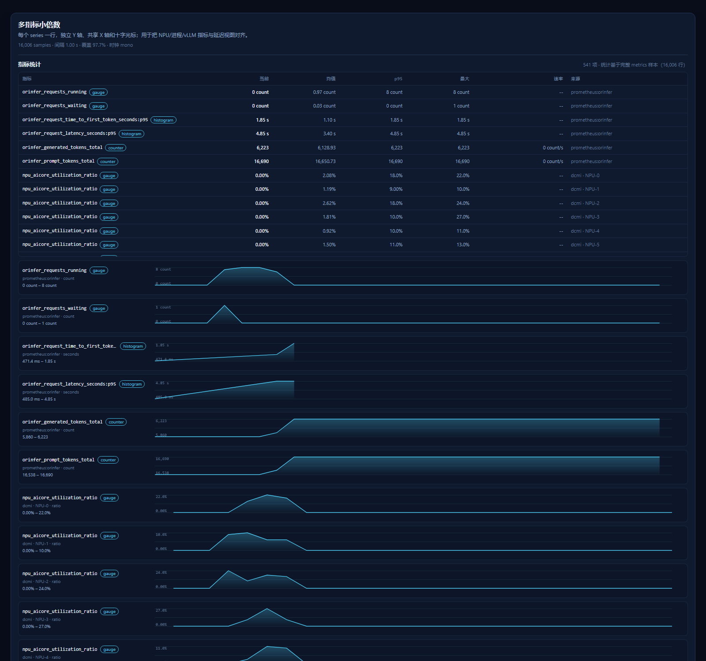
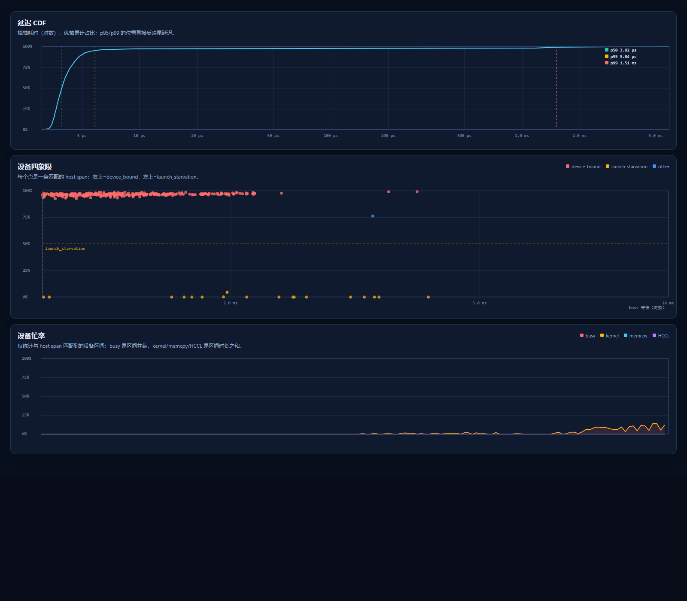
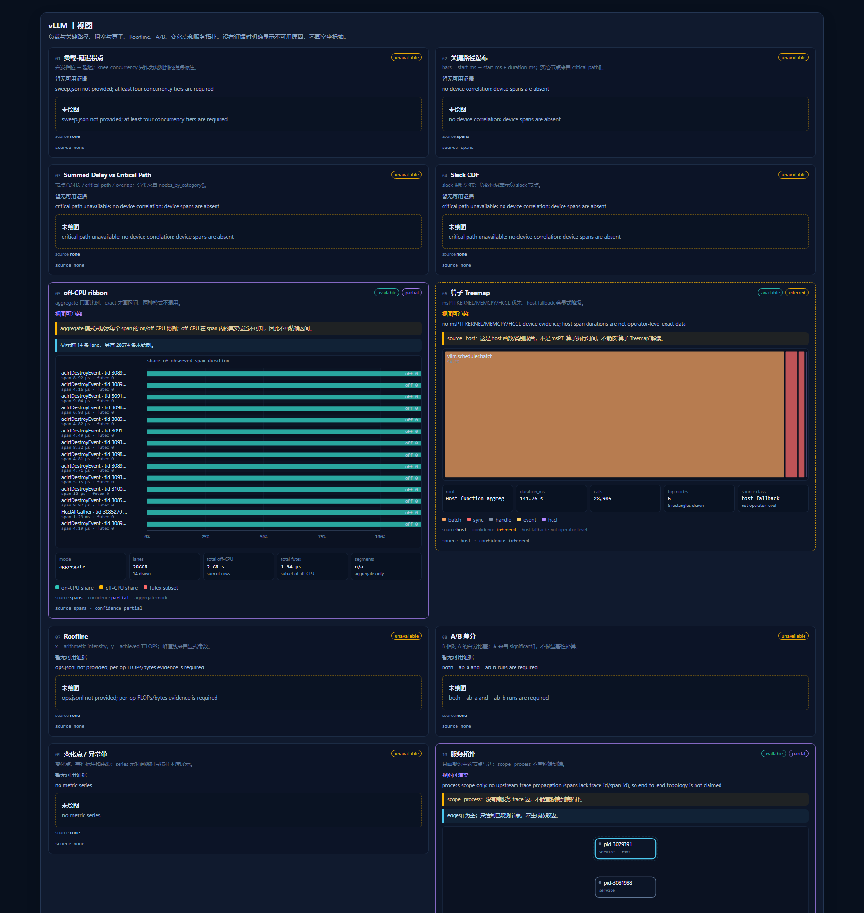
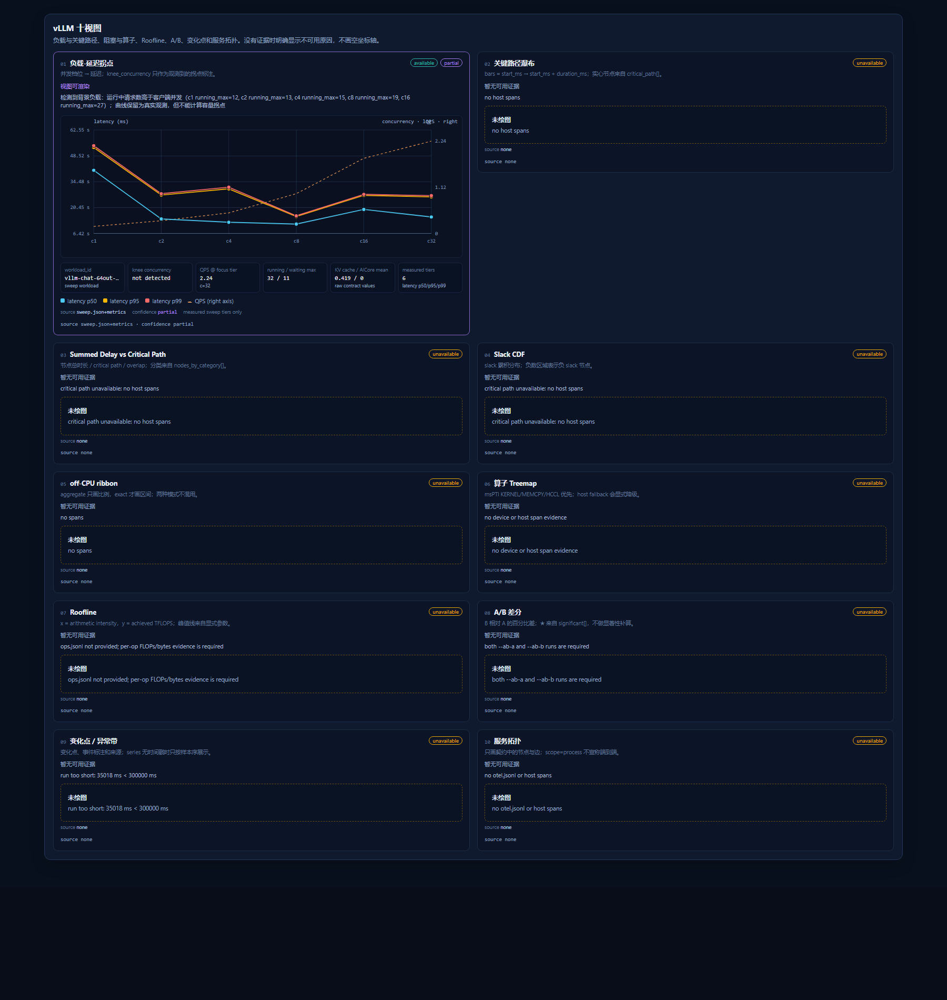
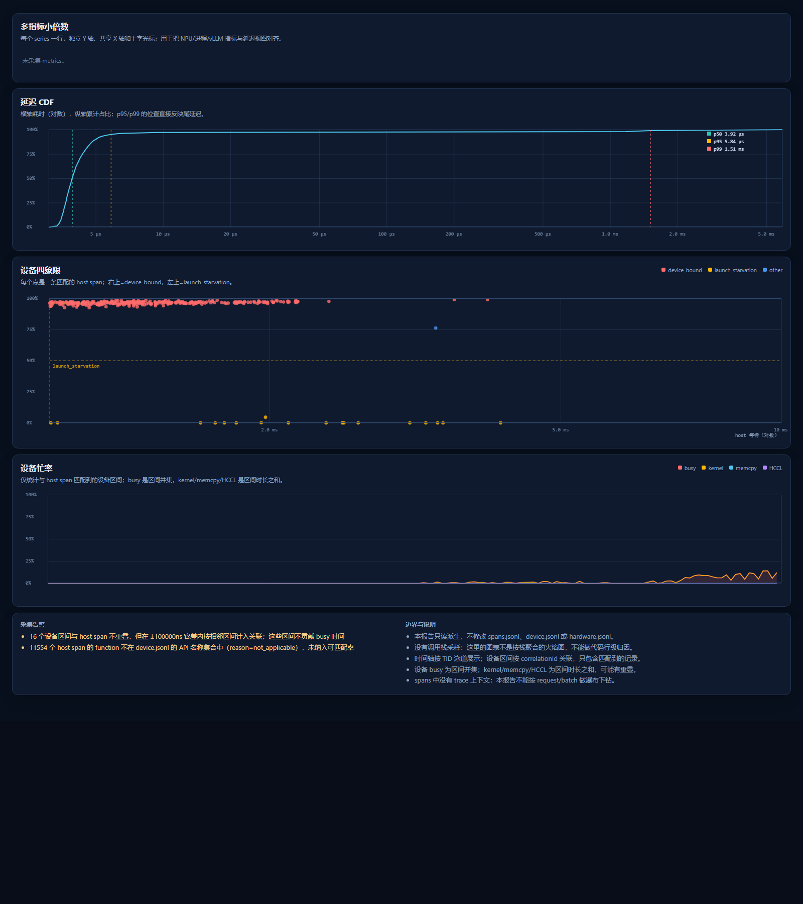

# cann-ebpf

> 交接文档：`docs/HANDOFF.md`（项目地址、已完成内容、下一步工作方向、硬约束）。

昇腾 CANN 主机侧低开销观测工具。当前交付版本为 **`0.6.0-m2`**，并已合入 M3 设备时间线采集器：

- 37 个 CANN/ACL/HCCL host uprobe 程序，entry/return 配对；
- vLLM-Ascend 自动发现、8 个 `VLLM::Worker_TP` 并行 attach、frontend/EngineCore 覆盖；
- batch 上下文协议、可选 vLLM general plugin 适配器，以及不依赖插件的纯 eBPF batch 采集；
- JSONL、manifest、summary 证据链；
- 只读 `diagnose` 定位命令（JSON/Markdown，不 attach）；
- 只读 `report` 性能仪表盘（单文件离线 HTML，不 attach、不联网）；
- M2 host off-CPU/futex（`sched_switch` + futex syscall tracepoint，已在 V4 和合成锁竞争上验证）；
- 独立 metrics 采集（`cann-ebpf sample`）与 `attach` 同窗口自动采样（DCMI/npu-smi/Prometheus），report 多指标叠加，不改写 spans/device/hardware 原始证据；
- vLLM 十视图（负载-延迟、关键路径、Summed Delay、Slack CDF、off-CPU、算子 Treemap、Roofline、A/B、变化点、服务拓扑），缺证据时明确不可用；
- E 层 npu-smi 硬件采样（HBM/AICore/功耗/温度，已上机验证）；
- M3 device 时间线 join 管线 + in-process msPTI collector（合成 ACL 已验证，生产注入待维护窗口）；
- 采集前后健康检查、uprobe 残留检查和不覆盖旧证据的运行脚本。

> 本版本的 `M4` 指 **vLLM-Ascend host profile + batch 上下文协议**。它仍然不是
> msPTI 设备时间线，也不做请求粒度的执行时间归因。没有插件上下文时，host span 会明确
> 标记为 `attribution.level=thread`；纯 eBPF batch span 单独标记为
> `attribution.source=ebpf_scheduler_output_dict`，不会伪造更细粒度的归因。

指标作用、`attach` 字段到图表的映射、全部图表、命令参数和降级语义见后文“指标、图表与功能总览”。

> 交互式全部图表：[`docs/demo/all-charts.html`](docs/demo/all-charts.html)

## 快速开始 / 使用手册

**完整步骤见 [`docs/USAGE.md`](docs/USAGE.md)**：从零安装/构建 → `preflight` → `attach` → `sample` →
`report` → `sweep`，含输出文件、常见问题、可选能力前提和权限/安全注意事项。下面是 5 分钟路径：

```powershell
# 0) 构建机交叉编译（目标机零运行时依赖，只需 root/CAP）
$env:CGO_ENABLED='0'; $env:GOOS='linux'; $env:GOARCH='arm64'
go build -buildvcs=false -trimpath -o dist/cann-ebpf-linux-arm64 ./cmd/cann-ebpf
```

```bash
# 1) 拷到目标机后先做只读环境检查（有 fail 退出码 4）
./dist/cann-ebpf-linux-arm64 preflight

# 2) 只读发现目标进程/符号（不 attach）
./dist/cann-ebpf-linux-arm64 discover --profile vllm-ascend --profiles-dir profiles --dry-run

# 3) 短窗口采集 host span + 指标，并自动出离线报告
OUT="runs/ebpf-$(date -u +%Y%m%dT%H%M%SZ)"
./dist/cann-ebpf-linux-arm64 attach --pid auto --profile vllm-ascend --profiles-dir profiles \
  --duration 10s --blocking on --hardware on --metrics auto \
  --output "$OUT" --report auto
```

能力分两类，**不要假设所有图表都有**（缺证据时视图显示 `unavailable`/`partial`，不补造）：

| 类别 | 代表能力 | 前提 / 代价 |
|---|---|---|
| **开箱即用**（只读、短窗口、不改目标） | `preflight`/`discover`、host span、off-CPU/futex、npu-smi 硬件（HBM/AICore/功耗/温度）、`sample` 指标（DCMI/进程/cgroup/system/Prometheus）、离线 `report`、`metrics` exporter | root/CAP + 内核选项；不停服务、不改目标进程/库/驱动/sysctl |
| **需要维护窗口/额外数据** | 真实 device 时间线（`device.jsonl`）、msPTI 设备侧结论、vLLM 插件上下文、Roofline（`ops.jsonl`）、变化点（`events.jsonl`+长时序）、跨服务拓扑（`otel.jsonl`）、负载-延迟拐点（`sweep`+≥4 档）、A/B（两次同 workload run） | 需重启/`LD_PRELOAD` 注入、独立压测窗口或外部证据；缺少时对应视图不可用 |

命令与参数总览见 [`docs/USAGE.md`](docs/USAGE.md)，全部图表与证据门禁见后文“指标、图表与功能总览”。

## 当前状态

| 能力 | 状态 |
|---|---|
| M0 配置、发现、profile 匹配、ELF 符号解析 | 完成并在 V4 服务器验证 |
| 37 个 host uprobe / 74 个 entry-exit 程序 | 完成；V4 verifier/attach 通过 |
| V4 自动发现 | 完成；最终发现 10 个目标：8 Worker_TP + frontend + EngineCore |
| V4 自动 attach | 完成；10 秒采集 6,991 spans，8 个 Worker 均有数据 |
| batch 上下文协议 | 完成；非 root UID 982 客户端 smoke 通过 |
| vLLM general plugin | 代码和单测完成；**未装入/重启正在运行的 V4** |
| JSONL / manifest / summary | 完成；manifest 与 JSONL 的 count、bytes、SHA-256 一致 |
| 链路追踪 | 完成；batch trace 传播、summary trace 覆盖、trace 链路树 |
| 纯 eBPF CPython POC | 完成；合成 Python 3.12 和真实 V4 Worker 1452 均验证通过 |
| 纯 eBPF vLLM batch 标准采集 | 完成；`attach --python-batch` 已并入 `spans.jsonl`/`summary`，真实 V4 验证 10 个 batch、6 个 request ID，类型确认为 `SchedulerOutput` |
| `diagnose` 只读定位命令 | 完成；JSON `cann.diagnose.report.v1` + Markdown，单测覆盖全部过滤与判定分支，并已在 V4 真实 evidence 上只读运行 |
| M2 host off-CPU/futex | 完成并上机验证；V4 10 秒 `attached=4 failed=0`，合成锁竞争 `host_lock_contention` 1.00 |
| 独立 metrics 采集 | 完成；`cann-ebpf sample` 支持 DCMI/npu-smi、进程、cgroup、主机 system 和 Prometheus 源，输出 `cann.metrics.v1` JSONL |
| `attach` 自动 metrics | 完成；同一条采集命令内启动 DCMI/npu-smi、Prometheus、可选进程/cgroup/system 采样，写入同一 run 的 `metrics.jsonl`/`metrics.meta.json` 并封存为 manifest artifact |
| 指标与可视化增强 | 完成；延迟热图、次秒偏移热图、分位带、尾 cohort、指标矩阵；metrics-only 也支持降级报告 |
| vLLM 十视图 | 完成代码和真实 vLLM 接入；真实 attach 与六档扫描报告见 `docs/M4-VIEWS2-VALIDATION.md`；严格关键路径、Roofline、A/B、OTel 拓扑仍按证据门禁显示 unavailable/inferred/partial |
| E 层 npu-smi 硬件指标 | 完成并上机验证；8 设备 HBM/AICore/功耗/温度，`hbm_pressure` |
| `preflight` 环境检查 | 完成并上机验证；V4 pass=15 warn=0 fail=0 |
| A3/A4/A5 | attach 系统级化（V4 墙钟 ~110s→~18s）、固定负载脚本、systemd/安装/升级/release 骨架 |
| A6 Prometheus exporter | 完成；`cann-ebpf metrics`，V4 证据 69 个 `cann_ebpf_*` 指标 |
| A7 硬件短间隔/DCMI | 2s 间隔 5 采样×8 设备，health 正常；`--hardware-backend dcmi` 已实现并在 V4 验证 |
| A8 M5 采集/对比 | `m5_capture.sh`/`m5_compare.py`，双 V4 run smoke 通过 |
| M2 开销 | agent +0.28pp 单核 CPU、+1.3MB RSS、0 丢事件；固定负载门禁用 A4 脚本 |
| M3 device 时间线 join | join/schema/diagnose 完成；真实 V4 span + 合成时间线 100% 匹配；`msprof --pid` 段错误，生产端待维护窗口 |
| M3 msPTI collector | 完成并在合成 ACL 验证；final7 慢 Sync 305/305（100%）；真实 V4/Orinfer 注入待维护窗口 |
| Orinfer profile | 配置校验通过；服务未运行，尚无运行窗口验证 |
| msPTI / 设备 kernel 时间线 | 代码 + 合成验证完成；真实 V4/Orinfer 设备时间线待维护窗口 |
| `execute_model` 函数级耗时 | 未实现；本轮不激活插件 |

## 快速构建

Windows 本机：

```powershell
$env:CGO_ENABLED = "0"
go test ./...
go vet ./...

$env:GOOS = "linux"
$env:GOARCH = "arm64"
go build -buildvcs=false -trimpath -o dist/cann-ebpf-linux-arm64-m3 ./cmd/cann-ebpf
go build -buildvcs=false -trimpath -o dist/cann-ebpf-linux-arm64-m1m2 ./cmd/cann-ebpf
go build -buildvcs=false -trimpath -o dist/cpy-poc-linux-arm64 ./cmd/cpy-poc
go build -buildvcs=false -trimpath -o dist/cpy-batch-poc-linux-arm64 ./cmd/cpy-batch-poc
Remove-Item Env:GOOS, Env:GOARCH, Env:CGO_ENABLED
```

当前 Linux/arm64 二进制 SHA-256 以交付包 `SHA256SUMS` 为准，构建后不得手工修改：

```text
cann-ebpf-linux-arm64-m3  见 dist/SHA256SUMS.txt（本次 M3 构建）
cann-ebpf-linux-arm64-m1m2  4fd7bd27ccfcc39d1111bb989698989da8c92913752a4cc15952606d40cf1f2e
cpy-poc-linux-arm64       08a5f05f92c15dd2d4b6475805ebbb3bfc3188b024c900745cb604a30826be53
cpy-batch-poc-linux-arm64 见 batch POC 交付目录 SHA256SUMS
```

`cann-ebpf-linux-arm64-m3` 已在 `目标 V4 环境（主机名省略）` 上完成 V4、合成锁竞争、硬件层、preflight 和
M3 合成 ACL 验证；M3 生产注入仍待维护窗口，详见 `docs/M3-FEASIBILITY.md`、`docs/M3-VALIDATION.md`。

仓库已包含 `internal/probes/bpf/cann.bpf.o`。修改 `cann.bpf.c` 后必须用 clang BPF
target 重新生成对象；不要依赖目标机现编，也不要修改目标进程或 CANN 库。

## 部署

### 依赖

**目标机（Linux/arm64）零运行时依赖。** `cann-ebpf` 是纯 Go 静态编译的单一二进制，
不依赖 `libc`、Python、容器运行时或 CANN 头文件；Prometheus exporter 也编译在同一二进制里。

前提是内核编译选项（`CONFIG_BPF_SYSCALL`、`CONFIG_UPROBE_EVENTS`、`CONFIG_DEBUG_INFO_BTF`、
`CONFIG_PERF_EVENTS`），openEuler 5.10 默认满足。正式运行前用 `preflight` 确认：

```bash
/opt/cann-ebpf/bin/cann-ebpf preflight
```

**构建机（Windows）** 需要 Go 1.24 和 clang（LLVM BPF target，仅修改
`internal/probes/bpf/cann.bpf.c` 时需要）。日常只改 Go 代码时不需要 clang，
也不需要 CANN 头文件或 Linux 交叉编译工具链。

### 发布包与安装

`sh scripts/make-release.sh --apply` 生成：

```text
cann-ebpf-<version>/
├── bin/cann-ebpf             # 静态编译的 Linux/arm64 二进制
├── profiles/                 # vllm-ascend / orinfer / cann-generic
├── configs/base.yaml
├── deploy/                   # install/uninstall/upgrade、capture-once、systemd unit+timer
├── scripts/                  # 采集、smoke、开销、M5 对比
├── docs/
├── adapters/vllm_ascend/
├── m3/mspti_collector/       # 容器内 msPTI collector 源码（不含构建产物）
├── SHA256SUMS.txt
└── README.md
```

安装到 `/opt/cann-ebpf`（默认 dry-run，`--apply` 才写主机，会校验 SHA-256）：

```bash
tar xzf cann-ebpf-0.6.0-m2-m3.tar.gz
cd cann-ebpf-0.6.0-m2-m3
sh deploy/install.sh --dry-run
sh deploy/install.sh --apply --binary bin/cann-ebpf
```

安装后布局：`/opt/cann-ebpf/{bin/cann-ebpf,capture-once.sh,profiles,configs,docs}`，
以及 `/etc/systemd/system/cann-ebpf.{service,timer}`（每 5 分钟一次短采集）。

卸载/升级：

```bash
sh deploy/uninstall.sh --dry-run --keep-data
sh deploy/uninstall.sh --apply --keep-data

sh deploy/upgrade.sh --dry-run --binary bin/cann-ebpf
sh deploy/upgrade.sh --apply   --binary bin/cann-ebpf
```

升级会先备份到 `/opt/cann-ebpf.bak.<UTC>`，失败自动回滚。完整说明见 `docs/OPERATIONS.md`。

### 使用模式

`cann-ebpf` 是**诊断工具**，不是常驻监控 agent；推荐按需短窗口运行：
`preflight` → `discover --dry-run` → `attach --duration 10s` → `diagnose` / `report`。
完整命令、参数与降级说明见 [`docs/USAGE.md`](docs/USAGE.md)。

一键/批量采集脚本（都会拒绝覆盖旧证据）：

| 脚本 | 用途 |
|---|---|
| `scripts/m5_capture.sh` | 采集 + health/service 检查 + uprobe 残留检查 |
| `scripts/server_auto_capture.sh` | 服务器自动采集（`DURATION`/`METRICS`/`REPORT`/`PROMETHEUS_URL` 等可用环境变量覆盖） |
| `scripts/run_metrics_window.sh` | 长窗口 metrics-only（≥5 分钟趋势/变化点） |
| `scripts/run_sweep.sh` | 并发压测编排（见下文 `sweep`） |

示例：`PROFILE=vllm-ascend DURATION=10s BINARY=./cann-ebpf sh scripts/m5_capture.sh`

## CLI

```text
cann-ebpf validate        校验配置或 profile
cann-ebpf preflight       只读环境检查（根/追踪点/权限/npu-smi）
cann-ebpf discover        只读发现进程、库、符号和 offset
cann-ebpf attach          eBPF uprobe 采集
cann-ebpf attach-tracefs  tracefs 后备采集
cann-ebpf trace           按 trace_id/parent 聚合 spans.jsonl
cann-ebpf diagnose        只读定位报告（JSON/Markdown）
cann-ebpf report          只读性能仪表盘（单文件 HTML）
cann-ebpf sample          独立 metrics 采集（DCMI/npu-smi/进程/cgroup/system/Prometheus）
cann-ebpf metrics         Prometheus 指标（text 或 /metrics）
cann-ebpf version         版本和平台
```

### vLLM 十视图报告

指标作用、全部图表和功能索引见后文“指标、图表与功能总览”。

十视图并存于原有仪表盘 `views_v2` 字段，报告只读原始证据。常用参数：

```bash
./cann-ebpf report --input "$OUT" \
  --metrics "$OUT/metrics.jsonl" \
  --sweep "$OUT/sweep.json" \
  --ops "$OUT/ops.jsonl" \
  --events "$OUT/events.jsonl" \
  --offcpu "$OUT/offcpu.jsonl" \
  --otel "$OUT/otel.jsonl" \
  --ab-a runs/a --ab-b runs/b --ab-workload-id fixed-workload \
  --roofline-peak-tflops 0 --roofline-peak-gbps 0 \
  --out "$OUT/report.html"
```

`sweep.json` 的每档 run 目录应包含 `metrics.jsonl` 和 `load.json`；`load.json` 的
真实起止窗口用于过滤服务端 histogram，窗口前的最后一个累计快照只作基线。
当 `vllm:num_requests_running` 高于客户端并发时，报告标记背景负载并拒绝计算容量拐点。
histogram 首帧是进程启动以来的累计值，报告跳过首帧，只使用相邻累计差值生成
`:p50/:p95/:p99`，不把 `_created` 时间戳当延迟，也不补造缺失点。

真实示例和证据限制见 `docs/M4-VIEWS2-VALIDATION.md`。

### 压测与报告：`sweep` 编排

`sweep` 是**独立的压测编排**，不是 `report` 的一部分：

1. **生产阶段**：按并发档跑固定负载 + `sample` 采 metrics，写
   `cN/load.json`、`cN/metrics.jsonl`，最后汇总 `sweep.json`；
2. **消费阶段**：只有显式给 `--report` 才调用 `cann-ebpf report` 出 HTML；
   不给就只生产证据，不生成报告。

```bash
# 只生产 sweep 证据（不发报告）
sh scripts/run_sweep.sh \
  --workdir runs/sweep-$(date -u +%Y%m%dT%H%M%SZ) \
  --tiers 1,2,4,8 --duration 30 --max-tokens 64 \
  --base-url http://127.0.0.1:8905 --model deepseek-v4-flash \
  --api-key "$VLLM_API_KEY" --bin ./cann-ebpf-linux-arm64-m3 \
  --yes

# 生产 + 消费，一条命令出报告
sh scripts/run_sweep.sh \
  --workdir runs/sweep-$(date -u +%Y%m%dT%H%M%SZ) \
  --run runs/ebpf-20261127T174000Z \
  --report runs/ebpf-20261127T174000Z/report-with-sweep.html \
  --tiers 1,2,4,8 --duration 30 --max-tokens 64 \
  --base-url http://127.0.0.1:8905 --model deepseek-v4-flash \
  --api-key "$VLLM_API_KEY" --bin ./cann-ebpf-linux-arm64-m3 \
  --yes
```

参数：

| 参数 | 说明 |
|---|---|
| `--workdir` | sweep 证据目录，默认 `runs/sweep-<UTC>` |
| `--run` | 已有 host run；只有 `--report` 时需要 |
| `--report` | 可选；`auto` 表示写到 `$RUN/report.html` |
| `--tiers` | 并发档，至少 4 档 |
| `--duration` | 每档负载时长 |
| `--max-tokens` | 固定输出长度 |
| `--base-url` / `--model` / `--api-key` | 被测端点 |
| `--yes` | 真正发负载；默认 dry-run |

产物：

```text
runs/sweep-<UTC>/
├── sweep.json
├── c1/{metrics.jsonl,load.json}
├── c2/{metrics.jsonl,load.json}
├── c4/{metrics.jsonl,load.json}
└── c8/{metrics.jsonl,load.json}
```

注意：

- **不需要停 V4**，但会给 V4 加测试负载；生产环境请在低峰/授权后执行；
- 每档必须有 `metrics.jsonl` + `load.json`，否则该档缺失；
- 如果 `running` 高于客户端并发，报告会标 `partial`，拒绝计算容量拐点；
- `report` 命令本身仍然只读，不会发压测；`sweep` 只在生产阶段发负载。

已有 sweep 样例可直接给 `report` 用：

```bash
cann-ebpf report \
  --input runs/live-20261127T174000Z \
  --metrics runs/live-20261127T174000Z/metrics.jsonl \
  --sweep .analysis/views2/sweep-real/sweep.json \
  --out runs/live-20261127T174000Z/report-with-sweep.html
```

### 校验 profile

```bash
./cann-ebpf-linux-arm64 validate --config profiles/vllm-ascend.yaml
./cann-ebpf-linux-arm64 validate --config profiles/orinfer.yaml
```

### 只读发现

```bash
./cann-ebpf-linux-arm64 discover \
  --profile vllm-ascend \
  --profiles-dir profiles \
  --dry-run --json > discover.json
```

最终 V4 discovery 发现 10 个目标；每个目标可解析 37 个已实现函数，覆盖
`libruntime.so`、`libascendcl.so`、`libhccl.so`、`libtorch_npu.so` 四类库。
缺失符号只保留为 discovery 信息，不会创建假 attach。

### 自动 attach

```bash
OUT="runs/ebpf-$(date -u +%Y%m%dT%H%M%SZ)"
./cann-ebpf-linux-arm64 attach \
  --pid auto \
  --profile vllm-ascend \
  --profiles-dir profiles \
  --duration 10s \
  --output "$OUT" \
  --metrics auto \
  --prometheus vllm=http://127.0.0.1:8000/metrics \
  --prometheus-include '^vllm:' \
  --report auto
```

`--report auto` 会在采集结束、teardown 和证据封存完成后，重新从磁盘读取
`spans.jsonl` 生成 `$OUT/report.html`；同一条 `attach` 命令采集的 `metrics.jsonl` 会自动叠加。
生成前会检查 `manifest.json` 的 `status=complete`，采集失败或 manifest 不完整时只保留
原始证据并返回非零退出码，不会把不完整的 run 画成成功报告。
只有报告生成失败时返回 `6`；此时 `spans.jsonl`、`manifest.json` 和 `summary.*` 仍保留，可继续用
`cann-ebpf report` 手动重试。

长时长采集会限制嵌入 HTML 的图表散点和 off-CPU ribbon 行数（默认 `--report-max-spans 20000`）；该抽样只影响
浏览器图表，`summary`、CDF、TopN 等统计仍使用完整 `spans.jsonl`，报告会显式记录
“图表抽样”警告。原始证据不会修改。

#### 单命令指标采样

`--metrics` 默认 `auto`，与 eBPF 采集使用同一个 `--duration` 和同一个 run 目录：

```bash
OUT="runs/ebpf-auto-$(date -u +%Y%m%dT%H%M%SZ)"
./cann-ebpf-linux-arm64 attach \
  --pid auto --profile vllm-ascend --profiles-dir profiles \
  --duration 5m --output "$OUT" \
  --metrics on \
  --metrics-npu-backend auto \
  --prometheus vllm=http://127.0.0.1:8000/metrics \
  --prometheus-include '^vllm:' \
  --metrics-proc --metrics-system \
  --report auto
```

参数与行为：

| 参数 | 默认 | 说明 |
|---|---|---|
| `--metrics` | `auto` | `auto` 探测 DCMI，失败再探测 npu-smi；`on` 要求至少有一个可用源；`off` 关闭 |
| `--metrics-npu-backend` | `auto` | `auto`/`dcmi`/`npu-smi`/`both`/`off`；显式指定后端缺失时直接报错 |
| `--metrics-interval` | `1s` | DCMI、进程、cgroup、system、Prometheus 的基础间隔；npu-smi 仍遵守最小 5s |
| `--prometheus` | 无 | 可重复，格式 `[name=]http(s)://host/metrics` |
| `--prometheus-include` | 全部 | Prometheus metric family allowlist 正则，可重复 |
| `--metrics-proc` | 关闭 | 采集已发现目标 PID 的 CPU/RSS 等 `/proc` 指标 |
| `--metrics-system` | 关闭 | 采集主机 CPU/load/memory/PSI/disk/net/thermal/frequency |
| `--metrics-cgroup` | 无 | cgroup v2 路径，可重复 |

输出写入同一个 run 目录：

```text
$OUT/
  metrics.jsonl          # cann.metrics.v1，一行一个采样点
  metrics.meta.json      # 采集窗口、series、时钟、SHA256、状态
  spans.jsonl            # eBPF 原始证据，不被 metrics 改写
  manifest.json          # metrics_jsonl / metrics_meta 作为 artifact 封存
  report.html            # --report auto 生成，自动读取上述 metrics
```

如果已有同名 `metrics.jsonl` 或 `metrics.meta.json`，`attach` 在启动采集前拒绝覆盖。
单个 metrics source 失败只写 warning，不会丢弃已经采集的 span；报告会按实际证据显示可用性，
不会把缺失指标补成 0。`hardware.jsonl` 仍是独立的粗粒度硬件层；需要避免与 metrics 的
npu-smi 采样重复时，使用 `--metrics-npu-backend dcmi` 或 `--hardware off`。

#### 按时间窗口分批采集

长时间 `attach` 会产生巨量 spans，既增加 teardown 成本，也会让 HTML 变重。经验规则：
**30–60 秒窗口采 host span + metrics；5 分钟以上只采 metrics**。`change_point` 要求
至少 5 分钟、30 个有效点；`load_latency` 需要 4 档以上并发，不是靠拉长单次窗口解决。

| 窗口 | 方式 | 解锁 | 代价 |
|---|---|---|---|
| 30–60s | `attach --metrics on` | host spans、off-CPU、TopN、拓扑、基础指标 | 中等；spans 量大，报告默认抽样 20000 点 |
| 6 分钟 | `sample --duration 360s` | `change_point`、短稳漂移 | 低；只写 metrics |
| 20–30 分钟 | `sample --duration 1200s/1800s` | KV cache、HBM/内存、队列长稳漂移 | 低；metrics 文件更大 |
| 4–6 档 × 30–60s | `sweep` + 固定 workload | `load_latency` 拐点 | 高；需要独立压测窗口 |

服务器上使用 `scripts/run_metrics_window.sh` 跑长窗口，脚本会拒绝覆盖已有目录：

```bash
cd /root/cann-ebpf
OUT=/root/cann-ebpf/runs/metrics-window-b-20261127T1819Z
DURATION=360s sh run_metrics_window.sh
```

采集完成后只读生成 metrics-only 报告：

```bash
./cann-ebpf-review report \
  --metrics /root/cann-ebpf/runs/metrics-window-b-20261127T1819Z/metrics.jsonl \
  --out /root/cann-ebpf/runs/metrics-window-b-20261127T1819Z/report.html
```

`vllm-ascend` profile 的 `handle` 探针默认按 `1/128` 采样，避免高频
`aclrtDestroyEvent` 淹没同步和事件 span。同步、event、memory、submit 和 HCCL
使用各自 profile 参数；只有真实触发且通过阈值/采样的调用才写入 JSONL。

uprobe 现在按库去重后 system-wide attach，BPF `target_pids` 过滤目标进程；
V4 上 37 个函数只需 74 个 perf event，采集 10 秒的总墙钟从 ~110s 降到 ~18s，
退出清理 ~4.5s。详见 `docs/A3-ATTACH-SCALING.md`。

硬件层默认走 `npu-smi`；也可用只读 DCMI helper：

```bash
gcc -O2 -o dcmi_probe m3/dcmi_probe/dcmi_probe.c \
  -I/usr/local/Ascend/driver/include \
  -L/usr/local/Ascend/driver/lib64/driver -ldcmi \
  -Wl,-rpath,/usr/local/Ascend/driver/lib64/driver
CANN_DCMI_PROBE=./dcmi_probe ./cann-ebpf-linux-arm64 attach ... \
  --hardware on --hardware-backend dcmi
```

### 上下文协议 smoke

```bash
OUT="runs/context-test-$(date -u +%Y%m%dT%H%M%SZ)"
OUT="$OUT" sh scripts/context-smoke.sh
```

脚本会：

1. 选择第一个 `VLLM::Worker_TP`；
2. 启动 collector 和 Unix socket；
3. 切换到目标进程 UID/GID 后发送 `batch_begin` / `batch_end`；
4. 校验 `batch_id`、request IDs、归因字段和 summary；
5. 检查 health、service 状态和 uprobe 残留。

最终 smoke 以 UID `982`、GID `979` 连接 socket，验证了容器同 UID 的
`SO_PEERCRED` 路径，而不是只用 root 自测。

### 纯 eBPF batch 采集（不装插件）

```bash
OUT="runs/ebpf-batch-$(date -u +%Y%m%dT%H%M%SZ)"
./cann-ebpf-linux-arm64 attach \
  --pid auto \
  --profile vllm-ascend \
  --profiles-dir profiles \
  --duration 10s \
  --python-batch \
  --no-context \
  --output "$OUT"
```

`--python-batch` 是可选的短时只读 uprobe。它不写目标进程、不安装 Python 包、不重启
V4，只读取 `SchedulerOutput.num_scheduled_tokens` 的请求 ID 键和 dict 身份。
`PyObject_GetAttr` 是高频 C API，默认不开启；`--no-context` 明确关闭插件 socket，
只保留纯 eBPF span。开启后会为每个命中 Worker 写一份
`python-batch-<pid>.json`，同时把 batch 窗口作为标准 `category=batch` span 写入
同一份 `spans.jsonl`。

### 只读定位：`diagnose`

```bash
# 直接读已有证据，不 attach
./cann-ebpf-linux-arm64-m2 diagnose --input runs/ebpf-20261126T000000Z
./cann-ebpf-linux-arm64-m2 diagnose --input runs/ebpf-... --pid 1452 --last 2s
./cann-ebpf-linux-arm64-m2 diagnose --input runs/ebpf-... --batch-id b-3 --json --out diagnose.json
```

输出命中 PID/TID/batch/request、top slow function/category、host off-CPU/futex 比例、证据 span，
以及“当前无法判定”的原因（缺 off-CPU、缺 msPTI、batch 非 request、插件未激活）。
时间窗使用与 span 相同的单调时钟 ns，详见 `docs/DIAGNOSE.md`。

### 只读性能仪表盘：`report`

```bash
# 读取一个 run 目录（spans.jsonl，可选 device.jsonl/hardware.jsonl），生成单文件 HTML
./cann-ebpf report --input runs/ebpf-20261126T000000Z --out report.html

# 同时叠加一次独立 metrics 采集；目录或 metrics.jsonl 都支持
./cann-ebpf sample --out runs/metrics-20261127T101500Z --dcmi --interval 2s --duration 30s
# 主机整体 CPU/load/memory/PSI/disk/net/thermal/frequency
./cann-ebpf sample --out runs/system-metrics-20261127T101500Z --system --interval 1s --duration 30s
./cann-ebpf report --input runs/ebpf-... --metrics runs/metrics-... --out report.html

# 调慢阈值/最小耗时、只看某个容器里的 device 时间线
./cann-ebpf report --input runs/ebpf-... --out report.html \
  --slow-threshold 5ms --min-duration 100us \
  --device-container-id <container-id>
```

报告是纯静态 HTML + 原生 Canvas，无外部 CDN/JS 依赖，可直接发给他人或用浏览器离线打开。
内容包括：线程时间轴（TID 泳道 + device stream 轨道，滚轮缩放/拖拽/密度条）、延迟散点
（时间 × 对数耗时，点击聚焦时间轴）、时间热力图（p95 或慢调用数）、TopN 函数、延迟 CDF、
设备四象限（host 等待 vs device busy）、设备忙率曲线，以及 M1/M2 新增的延迟热图、
次秒偏移热图、函数分位带、尾 cohort 和指标矩阵。所有图表都从既有证据只读派生，
不修改 `spans.jsonl` / `device.jsonl` / `hardware.jsonl` / `metrics.jsonl`。

边界：本节的 attach/span 报告没有调用栈采样，因此这不是按栈聚合的火焰图；需要内核栈请用
`stacks` + `report --stacks`。线程时间轴只到 TID/函数级，不能替代
msPTI 的 kernel 级时间线。缺 `device.jsonl` 时设备区显示不可用；只有 metrics 没有 spans 时生成
metrics-only 降级报告，函数级归因和设备四象限显示“无 span 证据”；两种情况都不会补造数据。
`metrics.jsonl` 是采样值，不是单次调用的关键路径；`HardwareAvailable` 只在确实存在 NPU series 时为真。

独立 metrics 契约与采集命令见 `docs/METRICS-SCHEMA.md`；并行开发边界见
`docs/M1-M2-DATA-CONTRACT.md`；图表选型与论文依据见 `docs/VISUALIZATION-RESEARCH.md`。

### 栈采样与火焰图：`stacks` / `report --stacks`

> 交付二进制：`dist/cann-ebpf-linux-arm64-stacks-final5`。旧的 m3 二进制没有 `stacks` 子命令。

`stacks` 只采集目标进程的 host kernel 栈（`perf_event_open` + BPF
`bpf_get_stackid`），不会采样全机，也不会重启或信号目标进程。perf 事件设置
`exclude_user=1`，只在内核态 on-CPU 时触发；用户态 Python/vLLM 时间不采样，也不
计入 `stack_fail`。产物是一个不可覆盖的 run 目录：`stacks.meta.json`、
`stacks.folded`，以及可选 `--raw` 的 `stacks.jsonl`。

```bash
# 显式 PID（可重复）；默认 30s / 99Hz
./dist/cann-ebpf-linux-arm64-stacks-final5 stacks \
  --pid 12345 --pid 12346 \
  --duration 30s --freq 99 \
  --out runs/stacks-$(date -u +%Y%m%dT%H%M%SZ)

# 自动选择 vLLM 进程树：vllm / VLLM::Worker_TP / EngineCore 及其子进程；
# orinfer 会被强制排除，选不到时直接报错并提示显式 --pid，不会退化为全机采样。
./dist/cann-ebpf-linux-arm64-stacks-final5 stacks --pid auto --profile vllm-ascend --duration 30s

# 保留原始地址，之后可重新符号化；默认规则文件缺失时使用内置类别规则
./dist/cann-ebpf-linux-arm64-stacks-final5 stacks --pid 12345 --raw \
  --symbols profiles/kernel-symbols.yaml
```

成功时打印一行可复核摘要：

```text
stacks out=runs/stacks-... samples=... unique=... stack_fail=... coverage=...% folded=... meta=...
```

`--kernel-filter npu` 会保留包含至少一个 NPU 帧的整条栈（保留 ioctl/el0_sync 上下文），
并在 meta warning 中记录保留/丢弃的栈数和样本数；`stack_fail`/`filtered` 仍是整轮计数。

2026-11-27 已在昇腾 910 主机（bms-84865758）做 10 秒只读基线：10 个 vLLM PID / 1357 线程，
1488 样本、221 条唯一栈、`stack_fail=6`（0.40%）、符号覆盖 100%、`filtered=0`、`lost=0`；
最终报告 NPU 帧加权占比 4.61%（630/13,658），Top NPU 为 `drv_ascend_intf_ioctl` 101 样本
（6.79% of 1,488）。final2 的 1420/218/9 是早期探针，不是交付口径。

失败语义：参数错误返回 `2`；perf/BPF 采集失败返回 `3`；符号化或写盘失败返回 `4`。
遇到权限问题会提示当前 `kernel.perf_event_paranoid`；符号覆盖不足会提示
`kernel.kptr_restrict` 和 `CAP_SYSLOG`。采集/符号化失败时不会写假 `stacks.folded`。

报告可以把栈采样作为独立顶层视图叠加到现有报告，也可以只给 `--stacks`（不需要
`--input`/`--metrics`）生成纯栈报告：

```bash
./dist/cann-ebpf-linux-arm64-stacks-final5 report --stacks runs/stacks-... --out stacks-report.html
./dist/cann-ebpf-linux-arm64-stacks-final5 report \
  --input runs/ebpf-... --stacks runs/stacks-... --out report.html
```

火焰图区块 `#flamegraphPanel` 与冻结的十视图契约分离：横轴是样本数、纵轴是栈深度，
颜色按类别；hover 显示函数/模块/样本数/self%/类别，点击缩放，搜索框高亮函数或模块，
类别图例可过滤。图上方显示采样率、样本数、丢失率、符号覆盖率、NPU 帧占比（帧加权，NPU 类帧次数 / total_frames）和
`stack_fail`；图下方始终保留 Top NPU 帧与类别 self 样本表，SVG 失败或无数据时显示
不可用原因而不是空图。`[unknown]` 帧会保留并归入 `unknown` 类别；树最多 4096 个节点、
128 层，超出部分合并为 `[truncated]` 并给出 warning。

边界：host kernel 栈只回答“CPU 当时在内核里做什么”，不能归因 AI Core
`MatMul`/`FlashAttention` 等设备算子执行时间；设备侧证据仍来自 msPTI/`device.jsonl`。

### M2 host off-CPU/futex 采集

```bash
OUT="runs/ebpf-m2-$(date -u +%Y%m%dT%H%M%SZ)"
./cann-ebpf-linux-arm64-m2 attach \
  --pid auto \
  --profile vllm-ascend \
  --profiles-dir profiles \
  --duration 10s \
  --blocking on \
  --no-context \
  --output "$OUT"
```

`--blocking auto|on|off`：`auto` 跟随 profile（`vllm-ascend`/`orinfer` 当前为 true），`on` 强制开启，
`off` 关闭。成功后最外层 CANN span 带可选 `offcpu_ns`/`futex_ns`（字段缺失=未测量，0=测得 0）；
嵌套 span 不采样，避免父子重复累计。blocking 程序单独加载，attach 失败只产生 warning，
不影响 host span 采集。

已在 `目标 V4 环境（主机名省略）` 验证：V4 10 秒 `attached=4 failed=0`、7,561 spans、无效样本 0；
合成 pthread mutex 竞争 off-CPU 99.7%、futex 99.9%、`host_lock_contention` 1.00。
数据与边界见 `docs/M2-VALIDATION.md` 与 `docs/M2-OFFCPU.md`。

### E 层硬件采样（npu-smi）

```bash
./cann-ebpf-linux-arm64-m2 attach --pid auto --profile vllm-ascend --profiles-dir profiles \
  --duration 10s --blocking off --hardware on --output runs/ebpf-hw
```

`--hardware auto|on|off`：`auto` 按 profile；采样写入 `hardware.jsonl`（manifest artifact），
`diagnose` 输出 8 设备 HBM/AICore/功耗/温度，并在 HBM free <5% 且存在慢 memory 调用时给出
`hbm_pressure`。硬件是 run 级 wall-clock 数据，不能逐调用 join。详见 `docs/HARDWARE.md`。

### device 时间线 join（M3，生产端待维护窗口）

外部 collector 产出 `device.jsonl` 后，用 attach 导入并抓 pidmap：

```bash
./cann-ebpf-linux-arm64-m3 attach --pid auto --profile vllm-ascend --profiles-dir profiles \
  --duration 30s --device-jsonl /host/path/device.jsonl --output runs/ebpf-m3
```

`diagnose` 会自动读取 run 目录的 `device.jsonl`（schema `cann.device.v1`），按
`(pid,tid,start±100µs)` 匹配 API record，再用 `correlationId` 关联 KERNEL/MEMCPY/HCCL；
有设备证据才输出 `device_bound` / `launch_starvation` / `copy_bound` / `communication_bound`。
`msprof --pid` 动态采集已确认段错误，真实 device 数据需要容器内 in-process collector + 维护窗口。
详见 `docs/M3-DEVICE-JOIN.md`、`docs/M3-FEASIBILITY.md`、`docs/WORK-SPLIT.md`。

### 一键采集

部署部分的 `server_auto_capture.sh` 封装了完整的采集流程（health 检查、
数据收集、服务确认、uprobe 残留检查），详见[部署 > 使用模式](#部署)。

## 指标、图表与功能总览

这一节是 README 的功能索引。所有图都只读派生自 `spans.jsonl`、`device.jsonl`、
`hardware.jsonl`、`metrics.jsonl` 和显式传入的旁路证据；没有证据时显示
`unavailable` / `partial` / `inferred`，不插值、不补点、不把 host 时间冒充设备时间。

### 报告图表（全部来自实际 HTML 产物）

**浏览器直接看全部图：** [`docs/demo/all-charts.html`](docs/demo/all-charts.html)。页面内嵌四份已生成的报告（真实 run 与合成验证样本分别标注），报告本身内嵌 `DATA` JSON，不依赖 CDN；Windows 可直接运行 `start docs/demo/all-charts.html`，Linux 可运行 `xdg-open docs/demo/all-charts.html`。`iframe` 内也能继续滚动、悬停和切换报告控件。

| 图 | 数据来源 | 指标 / `attach` 字段 | 覆盖的图表与功能 | 证据边界 |
|---|---|---|---|---|
| 图 1 | 真实 vLLM-Ascend attach：`vllm-ascend-20261127T072159.325022000Z`，16.37 s | `start_ns`/`end_ns` 计算的 duration、`pid`/`tid`、`function`/`category`、`manifest` | KPI、线程时间轴、延迟散点 | 28,905 spans、18 TID / 9 PID、dropped 0；没有 `device.jsonl` 时设备 KPI 显示 `--`，没有 trace 时不宣称 request 下钻 |
| 图 2 | 同一真实 attach run | duration、时间桶、函数分位、`offcpu_ns`/`futex_ns` | 时间热力图、TopN、延迟热图、次秒偏移热图、函数分位带、尾 cohort | off-CPU 是 `spans` 聚合的 `partial` 模式；不是调用栈火焰图，也不把 host 时间冒充设备执行 |
| 图 3 | 36 机器真实 Orinfer 8 请求轻载 metrics-only 报告，30 s | `metrics.jsonl` 的 gauge/counter/histogram；DCMI、proc、system、`prometheus:orinfer` | 指标矩阵、指标统计表、直方图窗口分位 | 16,006 点、541 series；没有 `spans.jsonl`，因此函数级时间轴、关键路径和设备四象限不可用 |
| 图 4 | final7 M3 device join 验证样本 | `device.jsonl` 的 `API`/`KERNEL`/`MEMCPY`/`HCCL`、`correlationId`、`streamId`，以及 host span 时间窗 | 延迟 CDF、设备四象限、设备忙率 | 11,859 host spans + 148,466 device spans、慢 Sync 305/305、可匹配率 100%、设备 busy 405.6 ms；设备侧是**合成 ACL**，只验证 join/UI 路径，不是生产性能结论 |
| 图 5 | 真实 vLLM attach run | `views_v2`、`batch_id`/`request_ids`、`offcpu_ns`/`futex_ns`、可选 device/ops/OTel 证据 | vLLM 十视图及每张卡的 `available`/`source`/`confidence` | `off_cpu` = available/partial；`operator_treemap` = available/inferred（host fallback）；`service_topology` = available/partial（process scope）；无 sweep/device/ops/A-B 的视图明确 unavailable |
| 图 6 | 真实六档并发扫描：c1/c2/c4/c8/c16/c32 | `sweep.json`、每档 metrics、服务端延迟/E2E、running/waiting、KV cache | 负载-延迟拐点，以及其余九张视图的证据门禁 | `load_latency` 保留真实观测但为 `partial`：背景 running 高于客户端并发，拒绝计算容量 knee；其余视图没有对应证据 |
| 图 7 | final7 报告的无 metrics 样本 | metrics 不可用、`manifest.warnings`、`dropped_events`、`notes` | 空态、采集告警、不可判定原因 | 这里展示的是“没有 metrics 就不画空曲线”的真实空态；空值不填 0，降级原因原样保留 |

#### 图 1：KPI、线程时间轴与延迟散点

[](docs/demo/all-charts.html#attach)

*真实 attach run；耗时、TID 泳道和离群点直接来自 `spans.jsonl`。设备关联和 trace 缺失时，报告显示不可用而不是补造。*

#### 图 2：时间热力图、TopN、延迟热图、次秒热图、函数分位带与尾 cohort

[](docs/demo/all-charts.html#attach)

*同一真实 attach run；`duration`、时间桶、函数名和函数分位驱动。尾 cohort 对比 slow（p99 以上）与 typical（p45–p55），不是平均值截图。*

#### 图 3：真实 36 机器 metrics 小倍数与统计表

[](docs/demo/all-charts.html#metrics)

*8 请求轻载、16,006 个采样点、541 series；展示 `orinfer_requests_running`、服务端延迟/E2E histogram、token counter、8 卡 AICore/HBM 等真实序列。该报告是 metrics-only，不提供单次调用的关键路径。*

#### 图 4：延迟 CDF、设备四象限与设备忙率

[](docs/demo/all-charts.html#device)

*final7 M3 join 验证样本；每个点是与 host span 匹配的设备区间，busy 为区间并集。因为来自合成 ACL，图只证明 join 计算和报告渲染正确，不能作为 V4 生产设备利用率结论。*

#### 图 5：vLLM 十视图与证据门禁

[](docs/demo/all-charts.html#attach)

*真实 attach run；`load_latency` 缺 sweep，`critical_path`/`summed_delay`/`slack_cdf` 缺 device 关联，`roofline` 缺 per-op FLOPs/bytes，`ab_diff` 缺两次 run，`change_point` 缺长时序 metrics。卡片显示的不是空白占位，而是带原因的 `unavailable`。*

#### 图 6：真实六档并发扫描

[](docs/demo/all-charts.html#sweep)

*真实六档扫描；`load_latency` 有真实曲线但为 `partial`。背景请求使 `running` 高于客户端并发，因此报告保留观测值、拒绝生成容量 knee；其他视图继续按证据门禁不可用。*

#### 图 7：无 metrics 的空态、告警和边界

[](docs/demo/all-charts.html#device)

*final7 没有 metrics 输入时，报告在 metrics 面板显示“未采集”，同时保留采集告警、dropped/error、边界说明和不可判定原因；没有用 0 或示意曲线填补。*

### 先判断要回答什么问题

| 问题 | 主指标 | 报告入口 | 需要的证据 |
|---|---|---|---|
| 时间花在哪个函数、线程、时间段 | `end_ns - start_ns`、function、category、PID/TID | 线程时间轴、延迟散点、时间热力图、TopN、函数分位带 | `spans.jsonl` |
| 是否存在长尾和慢调用 | p50/p95/p99、max、slow count、CDF | KPI、延迟 CDF、延迟热图、尾 cohort | `spans.jsonl`，慢阈值 |
| host 是在跑还是在等锁/等调度 | `offcpu_ns`、`futex_ns` | off-CPU ribbon、尾 cohort、`diagnose` | `attach --blocking on` |
| 是 host 慢还是设备慢 | host API 时长、device busy、KERNEL/MEMCPY/HCCL | 设备四象限、设备忙率、算子 Treemap、关键路径 | `device.jsonl` + host span 关联 |
| 并发升高后何时开始劣化 | concurrency、QPS、服务端延迟/E2E、running/waiting、KV、AICore | 负载-延迟拐点 | `sweep.json` + 每档 metrics |
| 版本或配置是否回归 | 两次同 workload run 的函数和 metric 差分 | A/B 差分 | 两个完整 run，workload_id 一致 |
| 指标什么时候发生结构变化 | 长时序 metrics + 事件 | 变化点/异常带 | 至少 5 分钟、30 个有效点 |
| 异常从一个服务传到哪个服务 | trace_id、parent_span_id、service | 服务拓扑 | `otel.jsonl`；缺失时只能显示进程级拓扑 |
| NPU 是否有 HBM、功耗、温度压力 | `npu_*` series 或 `hardware.jsonl` | 指标矩阵、指标统计、`diagnose` | DCMI/npu-smi 或 metrics 采集 |

### attach 字段到图表

| 字段/证据 | 指标作用 | 直接驱动的图表 | 边界 |
|---|---|---|---|
| `start_ns`、`end_ns`，报告计算 `duration = end_ns - start_ns` | 单次调用的 wall duration，是延迟、时间轴、分位统计的基础 | KPI、线程时间轴、延迟散点、延迟热图、函数分位带、延迟 CDF | 是 host 调用持续期，不是 request 延迟，也不是 NPU kernel 时间 |
| `function`、`category` | 识别 ACL、event、sync、memory、submit、HCCL、batch 等调用类型 | TopN 函数、时间轴颜色、函数分位带、算子 Treemap 的 host fallback | host fallback 必须标 `inferred`，不能称 msPTI 算子 |
| `pid`、`tid` | 进程/线程归因和并发观察 | 线程时间轴泳道、时间热力图 TID 行、KPI 的 PID/TID 数 | TID 归因只证明调用线程，不等价于 request 归因 |
| `batch_id`、`request_ids` | 把 batch 窗口和 request ID 关联起来 | 关键路径、Trace KPI、batch trace、vLLM 视图 | batch 是 `SchedulerOutput.num_scheduled_tokens` 窗口，不是单次调用的函数耗时 |
| `trace.trace_id`、`span_id`、`parent_span_id` | 构建父子链路和跨进程下钻 | `trace` 链路树、服务拓扑、关键路径的父子关系 | 没有上游 trace 时不能宣称端到端 |
| `offcpu_ns`、`futex_ns` | 调用线程在 CANN 调用期间的 off-CPU 和 futex 等待 | off-CPU ribbon、尾 cohort、`diagnose` 阻塞判定 | 只对最外层 span 采样；off-CPU 不等于一定在等锁 |
| `device.jsonl` 的 `API`、`KERNEL`、`MEMCPY`、`HCCL`、`correlationId`、`streamId` | 设备侧时间线、host/device 关联和设备忙率 | 设备四象限、设备忙率、算子 Treemap、关键路径、A/B 设备指标 | 没有真实关联时，相关视图必须不可用或标 `inferred` |
| `hardware.jsonl` 的 AICore、HBM、功耗、温度、health | run 级 NPU 资源快照 | `diagnose` 硬件表、报告 JSON、Prometheus exporter；不直接生成逐调用图 | wall-clock 采样不能和 monotonic host span 逐调用 join |
| `metrics.jsonl` 的 gauge/counter/histogram | 资源、队列、延迟分位和长期趋势 | 指标矩阵、指标统计、负载-延迟、变化点、A/B | 采样值不是单次调用关键路径；histogram 需按窗口增量计算 |
| `manifest.json` 的 status、warnings、dropped_events | 证明采集是否完整 | KPI 的 dropped/errors、采集告警、报告边界说明 | 有丢失或未完成时不能把结果当成完整证据 |
| 可选 `sweep.json`、`ops.jsonl`、`events.jsonl`、`offcpu.jsonl`、`otel.jsonl` | 负载扫描、Roofline、变更注释、精确 off-CPU、跨服务 trace | 对应 vLLM 十视图或精确模式 | 文件缺失时对应视图 unavailable，不能用近似数据替代 |

**图号对照：** `start_ns`/`end_ns`、`function`、`pid`/`tid`、`manifest` → 图 1–2；`offcpu_ns`/`futex_ns` → 图 2、图 5；`metrics.jsonl` → 图 3、图 6；`device.jsonl` → 图 4、图 5；`sweep.json`/`ops.jsonl`/`otel.jsonl` → 图 5–6。图 4/7 是设备验证或无数据边界，不用于生产性能结论。

### 固定报告区块（全部）

报告没有外部 CDN，Canvas/SVG 和模板都内嵌在单个 HTML 中，可离线打开。

| 区块 | 指标/算法 | 回答什么 | 无数据/降级 |
|---|---|---|---|
| KPI 卡片 | spans、PID/TID、p50/p95/p99、max、slow、device match、device busy、dropped、trace | 10 秒内判断这次 run 是否完整、慢不慢、有没有设备关联 | 缺 device 时设备 KPI 显示 `--`；缺 trace 时明确不能按 request 下钻 |
| vLLM 十视图 | 见下一节 | 负载、关键路径、等待、算子、Roofline、A/B、变化和拓扑 | 每个卡片独立显示 `available`、`source`、`confidence` 和原因 |
| 线程时间轴 | span 起止时间、TID/PID、function/category；有 device 时叠加 stream 轨道 | 看时间重叠、调用顺序、慢调用落在哪个线程和窗口 | 没有 span 时不画空时间轴 |
| 延迟散点 | x = 时间，y = 对数 duration；点击可聚焦时间轴 | 找离群点、周期性尖刺和慢调用集中区 | 没有 span 时显示空态 |
| 时间热力图 | 时间桶 × TID 行；可切换 p95 或慢调用数 | 看哪个线程在什么时间持续慢，而不是只能看单个点 | 行数受 `--max-lanes` 限制，截断会写 warning |
| TopN 函数 | 按 function 聚合 total、count、p50、p95、max、slow | 直接定位贡献最大的 CANN 调用 | 无函数数据时显示空态；采样函数仍按样本统计 |
| 延迟热图 | 时间桶 × 对数延迟桶，统计 count 和每列 p50/p95/p99 | 看延迟分布如何随时间迁移、是否出现双峰或长尾 | 无 span 时不可用 |
| 次秒偏移热图 | `(start_ns - window_start_ns) mod 1s` 分桶 | 看调用是否踩在秒边界的周期性尖刺上 | run 小于 2 秒或样本不足时不可用；这不是延迟图 |
| 函数分位带 | 每函数每时间桶的 p50 实线、p95 阴影、p99 虚线 | 看不同函数的长尾是否同时恶化 | 只显示总耗时前 12 个函数；空桶不插值 |
| 尾 cohort 对比 | slow（p99 以上）与 typical（p45–p55）的函数/类别/等待占比差 | 比较“慢请求多做了什么”，而不是只看平均值 | 样本不足时标 `insufficient sample`；没有 blocking 时标注无等待数据 |
| 指标矩阵 | 按“来源 + 指标名 + 单位”归并为组；每行一条组均值曲线，纵轴按本行 min–max 归一化；counter 自动转 Δ/s；点击行查看组内 series 的实际曲线 | 一次看几十组/数百条 series 的整体形态，再下钻 NPU/进程/PID 曲线，并与 span 窗口对齐 | 纵轴不能跨行比较绝对值；样本不足的组标注“未画曲线”；没有 metrics 时不画空图；间隔过粗会标 `coarse` |
| 指标统计表 | 每个 series 的 last、mean、p95、max、counter rate、source、device | 快速看当前值、峰值和高频变化，定位资源或队列压力 | 只展示有统计的 series；p50/p99 保留在报告 JSON；统计基于 downsampling 前原始点 |
| 延迟 CDF | 全部 span 的 duration 累积分布 | 看整体分布和 p50/p95/p99，不被单个最大值带偏 | 没有 span 时显示空态 |
| 设备四象限 | x = host 等待（对数），y = device busy%；颜色 = verdict | 区分 `device_bound`、`launch_starvation`、host 等待和普通调用 | 没有 host/device 关联时显示不可用 |
| 设备忙率 | 时间桶内设备区间并集，叠加 kernel/memcpy/HCCL 分量 | 看设备是否持续忙、忙在什么类型的操作上 | 没有 `device.jsonl` 或未匹配时不可用 |
| 采集告警与边界 | warnings、notes、unknowns、不可判定原因 | 解释为什么某张图不能给出结论 | 必须保留真实错误和降级原因，不伪造成功 |

### vLLM 十视图

| 视图 | 用到的指标/字段 | 图表作用 | 可用门槛与置信度 |
|---|---|---|---|
| `load_latency` 负载-延迟拐点 | 每档 concurrency、QPS、服务端延迟 p50/p95、latency p50/p95/p99、running/waiting、KV cache、AICore | 并发升高时延迟和吞吐如何变化，观察容量拐点 | 至少 4 个并发档；背景 running 高于客户端并发时标 `partial` 且不计算 knee |
| `critical_path` 关键路径瀑布 | batch/trace 节点、host start/duration、设备关联节点 | 看一个 batch/request 中哪些节点在关键链上 | 需要 batch/trace 上下文和可关联 device；没有 stream 依赖时只能是 `inferred` |
| `summed_delay` | 叶子节点总时长、critical path、overlap、parallelism、分类汇总 | 判断串行关键路径和并行重叠哪个是主要成本 | 依赖关键路径；只汇总叶子，避免父子重复计算 |
| `slack_cdf` | 每个节点的 earliest/latest start、slack_ms | 看多少节点没有时间余量，负 slack 表示约束冲突 | DAG 不完整或样本少于 30 时不可用 |
| `off_cpu` off-CPU ribbon | `offcpu_ns`、`futex_ns`、span 窗口；可选精确区间 | 区分 CPU 执行、非 futex 阻塞和 futex 锁等待 | 只有精确 `offcpu.jsonl` 才画区间；否则 `aggregate` + `partial` |
| `operator_treemap` 算子 Treemap | msPTI KERNEL/MEMCPY/HCCL 的 duration、count、device、stream | 看设备时间由哪些算子、拷贝或通信贡献 | 优先 msPTI `exact`；没有设备证据时只能 host fallback `inferred` |
| `roofline` | `ops.jsonl` 的 flops、bytes、duration，显式 peak TFLOPS/GB/s、dtype | 判断算子是算力受限还是带宽受限 | 没有 per-op FLOPs/bytes 或显式峰值时不画点 |
| `ab_diff` | 两个 run 的 metrics、function、component、slow count | 比较 B 相对 A 的吞吐、延迟、函数和资源变化 | workload_id 必须一致；不同 workload 或 run 不完整时拒绝比较 |
| `change_point` 变化点/异常带 | 长时序 metrics、events 标注 | 找出均值/方差发生变化的时刻，并关联部署、扩缩容或故障 | 少于 5 分钟或少于 30 个有效点时不可用 |
| `service_topology` 服务拓扑 | OTel trace 的 service、parent_span_id；无 OTel 时使用 host PID | 查看调用链拓扑和上下游关系 | 没有 OTel 时只能 `scope=process`，不能宣称端到端 |

### metrics 指标族与作用

| 指标族/来源 | 关键指标 | 指标作用 | 主要图表 |
|---|---|---|---|
| vLLM 队列与显存 | `vllm:num_requests_running`、`vllm:num_requests_waiting`、`vllm:kv_cache_usage_perc`、`vllm:gpu_cache_usage_perc` | 判断是否有排队、KV cache 压力和背景负载 | 指标矩阵、指标统计、负载-延迟 |
| vLLM 请求延迟 histogram | `vllm:time_to_first_token_seconds`、`vllm:e2e_request_latency_seconds` | 观察服务端延迟直方图的窗口 p50/p95/p99，而不是进程启动以来的累计值 | 指标矩阵、指标统计、负载-延迟 |
| vLLM token/请求计数 | `vllm:prompt_tokens_total`、`vllm:generation_tokens_total`、`vllm:request_success_total`、`vllm:request_prompt_tokens`、`vllm:request_generation_tokens` | 计算 token/请求速率、成功/abort/error 变化，辅助 A/B 和变化点 | 指标矩阵、指标统计、A/B |
| NPU 资源 | `npu_aicore_utilization_ratio`、`npu_hbm_used_ratio`、`npu_hbm_free_bytes`、`npu_memory_used_bytes`、`npu_power_watts`、`npu_temperature_celsius`、`npu_health` | 判断算力利用率、HBM 余量、功耗墙和热限 | 指标矩阵、指标统计、负载-延迟、变化点、A/B |
| 进程级（`sample --pid`） | `proc_cpu_*`、`proc_rss_bytes`、`proc_vm_size_bytes`、`proc_threads`、`proc_fds`、`proc_sched_run_delay_seconds`、`proc_context_switches_*`、`proc_io_*` | 判断 Worker 自身 CPU、内存、线程、fd、调度延迟和 I/O | 指标矩阵、指标统计、A/B |
| cgroup v2（`sample --cgroup`） | `cgroup_cpu_usage_seconds`、`cgroup_cpu_throttled_seconds`、`cgroup_cpu_nr_throttled`、`cgroup_memory_*`、`cgroup_pids_*`、`cgroup_*_pressure_*` | 判断容器 CPU 配额、内存上限、OOM 事件和 PSI 压力 | 指标矩阵、指标统计、变化点 |
| 主机整体（`sample --system`） | `node_cpu_seconds_total`、`node_load1/5/15`、`node_memory_*`、`node_pressure_*`、`node_disk_*`、`node_network_*`、`node_thermal_celsius`、`node_cpu_frequency_hz` | 提供主机 CPU、内存、PSI、磁盘、网络、温度和频率背景 | 指标矩阵、指标统计、变化点 |
| 任意 Prometheus | `sample --prometheus` 解析出的低基数 gauge/counter/histogram | 接入 LiteLLM、网关或其他 exporter；不硬编码业务指标名 | 指标矩阵、指标统计、变化点、A/B |
| `hardware.jsonl` | `aicore_pct`、`hbm_used/total/free`、`power_w`、`temp_c`、`health` | run 级 NPU 快照和 `hbm_pressure` 线索 | `diagnose` 硬件表、报告 JSON、Prometheus exporter；无逐调用硬件图 |

### 指标口径（不要混用）

- span 指标是函数级 wall time；metrics 是采样序列；batch 是调度窗口；device 是设备时间线。四者不能互相冒充。
- span 的 p50/p95/p99 是 nearest-rank；metrics histogram 的 `:p50/:p95/:p99` 来自相邻累计快照差值的桶内插值。
- Prometheus histogram 首帧只作为基线；首个快照不生成窗口点，`_created` 时间戳不参与延迟统计。
- gauge 直接保留观测值；counter 的 `rate_last/rate_mean` 只用正增量，reset 不解释成负速率；histogram 不作为 counter 计算 rate。
- 指标统计基于 downsampling 前的完整样本；绘图可以降采样，但不会改变统计表。
- 缺失点不插值、不填零；窗口外点被丢弃并写 warning；tracing 缺失时保留 `unknown`，不生成虚假因果。
- `--python-batch` 只读取 `SchedulerOutput.num_scheduled_tokens` 的 request ID 键，不能推导单次调用执行时长。
- `hardware.jsonl` 是 wall-clock run 级采样；不能和 monotonic host span 做逐调用 join；需要逐调用设备证据时使用 `device.jsonl`。
- 没有内核栈采样数据就不画火焰图；没有 per-op FLOPs/bytes 就不画 Roofline 点；没有 OTel 就不宣称端到端拓扑。

### attach 开关与证据

| 开关 | 产生的证据 | 对应图表 | 关闭/失败时 |
|---|---|---|---|
| `--blocking auto/on/off` | 最外层 span 的 `offcpu_ns`/`futex_ns` | off-CPU ribbon、尾 cohort、`diagnose` | `off` 或 attach 失败时 off-CPU 视图 unavailable，主 span 采集继续 |
| `--python-batch` | batch span、`batch_id`、`request_ids`、逐 Worker JSON | 关键路径、Trace KPI、batch 覆盖 | 不开启就没有 batch 维度的真实关联 |
| `--hardware auto/on/off` | `hardware.jsonl`（AICore/HBM/功耗/温度/health） | `diagnose` 硬件表、报告 JSON、exporter | `off` 或失败时 `hardware.available=false` |
| `--device-jsonl <path>` | 导入外部 msPTI `device.jsonl`、meta 和 pidmap artifact | 设备四象限、设备忙率、算子 Treemap、关键路径 | 没有 device 文件时不生成设备级结论 |
| `--no-context` | 不启动插件 socket，只保留 eBPF span 和可选 python batch | 线程时间轴、batch 视图 | 没有插件上下文时不能按 request 下钻 |
| `--hardware-backend npu-smi/dcmi` | 选择硬件采样后端 | 硬件采样与 exporter | 后端不可用时只写 warning，不影响 host span |

### 全部 CLI 功能

| 命令 | 产出 | 在报告中的位置/用途 | 是否形成图表 |
|---|---|---|---|
| `validate` | profile/config 校验结果 | 防止错误 profile 进入 attach | 否 |
| `preflight` | 根权限、tracefs、BTF、BPF、NPU 工具检查 | 判断当前主机能不能采 | 否 |
| `discover` | target PID、库、符号、offset JSON | 解释 attach 覆盖了哪些目标 | 否 |
| `attach` | `spans.jsonl`、`manifest.json`、`summary.json/md`、可选 `hardware.jsonl`、`python-batch-*` | 所有 attach 图表和十视图的基础证据 | 是，经 `report` |
| `attach-tracefs` | tracefs 后备 span 证据 | 无 uprobe 条件时的降级采集 | 是，格式允许时经 `report` |
| `trace` | trace_id、batch、CANN span 的链路树 | 从 batch/request 下钻到调用链 | 文本/JSON 链路树，不是 Canvas 图 |
| `diagnose` | JSON/Markdown 的命中 PID/TID/batch、slow 函数、blocking、hardware、device verdict、unknowns | 只读定位和判定；与报告互补 | 表格/文本，不是图表 |
| `report` | 单文件离线 HTML，含全部固定区块和十视图 | 本文所有图表的统一入口 | 是 |
| `sample` | `metrics.jsonl`、`metrics.meta.json`；支持 DCMI/npu-smi/proc/cgroup/system/Prometheus | 指标矩阵、指标统计、负载-延迟、变化点、A/B 的数据源 | 是，经 `report` |
| `metrics` | `cann_ebpf_*` Prometheus text 或 `/metrics` | 交给 Prometheus/Grafana 做长期存储和告警 | 外部看板，不是内置 HTML |
| `version` | 版本、平台、构建信息 | 证据可复现性 | 否 |

### 命令参数速查

完整 flag 表（`attach`/`report`/`sample`/`discover`/`diagnose`/`trace` 等全部参数、默认值和对应证据）
见 [`docs/USAGE.md`](docs/USAGE.md#附录-a-参数速查) 与各命令 `--help`。这里只列最常用入口：

| 命令 | 最常用参数 |
|---|---|
| `attach` | `--pid auto --profile vllm-ascend --duration 10s --blocking on --hardware on --metrics auto --output <dir> --report auto` |
| `sample` | `--out <dir> --interval 1s --duration 60s [--npu-smi --system --pid N --cgroup <path> --prometheus name=URL]` |
| `report` | `--input <run> [--metrics <目录或 metrics.jsonl>] [--sweep <sweep.json>] [--ops <ops.jsonl>] --out report.html` |
| `preflight` / `discover` / `diagnose` | `--json`；`discover --profile ... --dry-run`；`diagnose --input <run> [--pid N --last 5s]` |
| `metrics` | `--input <run> --listen <host:port>` 或 `--out <file>` |

### 推荐抓取组合

| 目标 | 采集 | 报告 |
|---|---|---|
| 只看 host 调用和线程 | `attach --duration 10s` | `report --input <run>` |
| 看 host 锁等待 | `attach --blocking on` | off-CPU ribbon、尾 cohort、`diagnose` |
| 看设备时间和按调用等待 | `attach --device-jsonl <device.jsonl>` | 设备四象限、设备忙率、关键路径、Treemap |
| 看容量和拐点 | 每档 `sample --prometheus ...` + 负载脚本 + `sweep.json` | `report --sweep ... --metrics ...` |
| 看版本 A/B | 两个同 workload、同窗口的完整 run | `report --ab-a ... --ab-b ... --ab-workload-id ...` |
| 看长期变化 | `sample --system --pid ... --cgroup ... --duration 10m` | 指标矩阵、指标统计、变化点 |
| 看跨服务拓扑 | `otel.jsonl` 或网关/LiteLLM trace | `report --otel ...` |
| 只有 metrics、没有 spans | `sample` 独立运行 | `report --metrics <run>` 的 metrics-only 降级报告 |

### 无数据与置信度语义

- `available=true` 表示视图的数据前提满足；`confidence=exact` 才表示有精确设备/区间证据，`inferred` 表示由 host 或时间关系推断，`partial` 表示窗口、背景负载或样本不完整。
- `available=false` 必须同时给出 `reason`；不显示空坐标轴、不生成示意曲线、不把 0 当作“没发生”。
- 背景负载高于客户端并发时，`load_latency` 保留真实观测但拒绝 capacity knee；必须等 `running=0` 的窗口才能宣称干净容量。
- 缺少 `device.jsonl`、`ops.jsonl`、`otel.jsonl`、`events.jsonl` 或精确 `offcpu.jsonl` 时，对应依赖视图保持不可用。

## 输出

```text
spans.jsonl      原始 host span，一行一个对象
manifest.json    运行环境、目标 PID、库 inode/size/mtime、统计、warnings、SHA-256
summary.json     派生 function/category/PID/context/batch 汇总
summary.md       人类可读派生摘要
python-batch-<pid>.json  纯 eBPF batch 的逐 Worker 统计、类型确认和 warnings
```

Span 新增字段：

```json
{
  "start_ns": 10162267042648145,
  "end_ns": 10162267057374196,
  "api": "aclrtSynchronizeEvent",
  "batch_id": "ctx-smoke-1",
  "request_ids": ["req-smoke-1", "req-smoke-2"],
  "offcpu_ns": 850000,
  "futex_ns": 700000,
  "attribution": {
    "level": "batch",
    "source": "protocol_smoke",
    "confidence": 1,
    "verdict": "batch_window"
  }
}
```

`offcpu_ns` / `futex_ns` 只在 M2 blocking 探针真正采集到该 span 时出现；没有字段表示未测量，
字段为 0 表示测得 0。它们属于调用线程，不是设备执行时间。

原始值以 `spans.jsonl` 和 `manifest.json` 为准。summary 不补造时间，不修改原始
事件；内存 span 缓冲达到上限时，summary 从完整 JSONL 重新生成，并在 warnings
中显式记录。

## 实测数据 Demo

> 下列数据来自真实 V4 生产服务的短窗口采集、合成锁竞争目标和合成 ACL 工作负载；
> 主机名、路径和访问地址已省略。合成数据用于验证代码路径，不是生产性能结论。

### 1. V4 host 采集（10 秒）

环境：openEuler aarch64，内核 5.10，CANN 9.0.1，vLLM-Ascend 0.23.0rc1。

| 项目 | 结果 |
|---|---|
| discovery | 10 targets；8 Worker_TP + frontend + EngineCore；每个 37/148 symbols |
| eBPF 10 秒 | 6,991 spans；dropped 0；8 个 Worker 均有 span |
| 函数分布（另一次 10 秒窗口，7,794 spans） | `aclrtSynchronizeEvent` 5,559；`aclrtDestroyEvent` 2,073（1/128 采样）；`aclrtSynchronizeStreamWithTimeout` 159；`aclrtRecordEvent` 1；`aclrtQueryEventStatus` 2 |
| 服务影响 | 采集前后 `/health` 均为 200；service 前后均为 `active` |
| uprobe 清理 | `cann_` 残留计数为 0 |
| 上下文 smoke | 164 spans；21 条 batch span；1 个 batch；2 个 request ID；验证失败项 0 |
| JSONL 完整性 | eBPF 6,991 行，SHA-256 `fb2625ba842c27c2480aa1750035acc6f61769849d31c23af462cd34fdd1c312` |

真实 span 行（字段节选，来自一次 blocking=on 的 V4 采集）：

```json
{
  "schema": "cann.span.v1",
  "pid": 1452,
  "tid": 1452,
  "function": "aclrtSynchronizeStreamWithTimeout",
  "category": "sync",
  "duration_ns": 15638197,
  "offcpu_ns": 14251417,
  "futex_ns": 0
}
```

这条 span 持续 15.64ms，其中 14.25ms 是 host 线程 off-CPU 等待；它说明“host 在等”，
不等于设备执行了 14.25ms。

### 2. M2 host 阻塞（V4 + 合成锁竞争）

| 场景 | spans | off-CPU 占比 | futex 占比 | 判定 |
|---|---:|---:|---:|---|
| V4 10 秒，blocking=on | 7,561 | 1.1% | 0.0% | `host_cpu_running` |
| 合成 pthread mutex 竞争 | 791 | 99.7% | 99.9% | `host_lock_contention`（置信度 1.00） |

两次采集均 `attached=4 failed=0`、无效样本 0。

### 3. E 层硬件（V4 运行时快照）

8 张卡全部可读；同一时刻 device 0 的原始行：

```json
{"schema":"cann.hardware.v1","device_id":0,"name":"910B2","aicore_pct":42,"hbm_used_mb":61404,"hbm_total_mb":65536,"power_w":216,"temp_c":43}
```

该窗口全卡最低 HBM 余量 6.3%，AICore 峰值 46%。硬件是整卡 wall-clock 快照，不能归因到单 Worker/单 request。

### 4. M3 设备时间线 join（合成 ACL final7）

| 指标 | 值 |
|---|---|
| host spans | 11,859 |
| device spans | 148,466（API 127,862 / KERNEL 4,112 / MEMCPY 16,492） |
| 可匹配设备调用 | 305 / 305（**100%**） |
| 慢 Sync 匹配 | 305 / 305（**100%**） |
| not_applicable | 11,554（`aclrtGetDevice` 11,536、`aclrtMalloc` 18） |
| 时钟偏移 | -18,359 ns |
| pidmap | 27 条容器 local → host pid/tid |
| 设备判定 | `device_bound` 286、`launch_starvation` 18 |

注意：这是合成 ACL 的 join 验证，不是 V4 真实设备性能结论。

### 5. Prometheus 指标输出（final7 证据）

```text
cann_ebpf_spans_total{run_id="cann-generic-20261126T111917.065391760Z"} 11859
cann_ebpf_device_match_rate 1
cann_ebpf_device_slow_sync_match_rate 1
cann_ebpf_blocking_measured 0
cann_ebpf_verdict{verdict="device_bound"} 1
cann_ebpf_verdict{verdict="launch_starvation"} 1
```

`blocking_measured=0` 是因为该 run 没开阻塞探针，不是 off-CPU 为 0；未知项会显式保留。

### 6. A3 attach 规模优化的真实效果（10 秒采集）

| 实现 | spans | 整次墙钟 | 采集后退出 |
|---|---:|---:|---:|
| per-pid uprobe（740 links） | 1,470 | 63.3s | ~50s |
| system-wide + BPF 过滤（74 links） | 1,618 | 16.7s | ~4.5s |

两次窗口业务流量不同，span 数有差异；8 个 Worker 均有数据，uprobe 残留 0。

### 7. 数据边界

- V4 host span 是真实调用；M2 合成锁竞争、M3 合成 ACL 是代码路径验证，不能当生产性能结论。
- 没有单 request 延迟，也没有 `execute_model` 函数级耗时。
- 设备结论只在存在真实 `device.jsonl` 且 join 匹配时成立。
- 主机名、服务器路径和访问地址均已省略。

## 已知边界

- 37 个函数已编译和 attach，但一次 10 秒窗口只观测到 6 类真实调用；不能宣称
  37 个函数全部在该窗口触发。
- vLLM plugin 尚未安装到运行中的容器，也未重启 V4 激活；smoke 使用的是同协议、
  同 UID 的合成客户端。真实插件请求级验证需要明确的维护窗口。
- `attribution.level=batch` 表示 span 时间窗与插件 batch 窗口重叠；不是单次调用的
  执行时间拆分。request IDs 是关联键，不是业务内容。
- 如果容器使用独立 time namespace，插件与 host eBPF 的单调时钟可能不一致；上线
  插件前必须做同一命名空间/跨命名空间时钟校准。
- msPTI kernel/memcpy/HCCL 的真实 V4/Orinfer 设备时间线尚未采集；collector 已在合成 ACL 上验证。
- M2 已上机验证，但只覆盖最外层 CANN span 的 host 阻塞；嵌套 span 没有 blocking 字段是设计行为。
  本次 V4 窗口没有真实 futex 竞争（futex≈0），`host_lock_contention` 由合成锁竞争目标验证。
- `offcpu_ns`/`futex_ns` 是 host 线程的等待时间，不是 request 延迟、不是 NPU 执行时间；
  没有 msPTI 时仍然不能下 `device_bound`/`launch_starvation`。
- 硬件层是周期性 wall-clock 快照，AICore/HBM 是整卡值，不能归因到单个 Worker 或单次调用。
- M3 的 final7 结果来自**合成 ACL**，不是 V4 生产流量；`msprof --pid` 动态采集段错误，真实设备数据
  需要维护窗口的 in-process collector。
- V4 上 740 个 uprobe 的进程退出清理约 40 秒（内核串行 detach，残留最终为 0），
  这是命令返回时间，不是采集窗口、也不影响业务；`capture_stop` 之后的清理不计入窗口。
- `diagnose` 只读已有证据；没有 off-CPU 采样时只输出 `blocking_unknown`，没有 msPTI 时永远不输出
  `device_bound` / `launch_starvation`。
- Orinfer 当前未运行；profile 只能声明配置校验通过，不能写成真实采集验证。
- tracefs 仍是单 PID 后备路径，本轮没有用 tracefs 重新验证 37 函数。
- 自动 attach 会先解析库、创建 uprobe；system-wide attach 后 10 秒采集的整次进程墙钟约
  18 秒（旧 per-pid 实现约 110 秒）。这仍是 setup/teardown 成本，不能把 wall time 当作采集时长。

## 安全约束

- 不停止、不重启 V4/Orinfer，不修改目标进程、容器、CANN 库、驱动或 sysctl。
- 不覆盖旧证据目录；每次运行生成新目录。
- 不把 prompt、响应、token tensor 或业务文本写入上下文协议。
- 上下文 socket 只接受 collector UID 和显式目标 UID；目录 `0755`，socket 默认
  `0600`，目标为非 root 时 chown 给目标 UID/GID 并设为 `0660`。
- 插件字段采用白名单解码，未知字段直接拒绝。
- 失败时保留真实错误、warnings、dropped events 和 `status=error`，不伪造成功。

## M5 链路追踪与纯 eBPF 采集

本轮新增 W3C 形状的 batch/CANN 链路追踪：

- batch span 是父节点，命中的 CANN span 派生 child `span_id`，写入 `trace` 对象；
- `summary.json` 增加 `trace_coverage`、`trace_sources` 和 `top_slow_traces`；
- `cann-ebpf trace` 可直接输出 trace 到 batch 再到 CANN span 的链路树；
- 旧插件没有 trace 字段时，collector 生成 `collector_local_batch` 本地 trace；
- 插件支持 `CANN_EBPF_TRACEPARENT` 做进程级上游继承；逐 HTTP request 传播尚未实现；
- 子 span 的 `batch_parent_span_id` 保留 batch 的上游父 span，batch span 本身仍不写入 JSONL。

`poc/cpython` 是纯 eBPF CPython 3.12 采集实现，现由 `attach --python-batch` 直接
使用：只挂 `PyObject_GetAttr` entry/return，过滤 `num_scheduled_tokens`，读取返回
dict 的 request ID 键，不读 value、prompt、响应或 tensor。支持 combined/split
unicode dict，单次最多 64 个 key；batch span 写入标准 `spans.jsonl`，逐 Worker
统计写入 `python-batch-<pid>.json` 并由 manifest 计算 SHA-256。合成 Python 3.12
和真实 V4 Worker 都已验证；该路径不能推导单次调用时长。

详细 schema、证据和边界见 `docs/M5-TRACE-AND-CPY-POC.md` 与
`poc/cpython/README.md`。

## 文档

- `docs/USAGE.md`：从零使用手册（安装/构建、preflight、attach、sample、report、sweep、可选能力前提、输出文件、FAQ、权限与安全）。
- `docs/PRODUCT.md`：成品说明（能力矩阵、证据文件、已验证/未验证边界）。
- `docs/HANDOFF.md`：交接总览、已完成/未完成、下一步与硬约束。
- `docs/DIAGNOSE.md`：`diagnose` 用法、时间窗语义、判定规则和边界。
- `docs/METRICS-SCHEMA.md`：`sample` 命令、`cann.metrics.v1`/`cann.metrics.meta.v1` 契约与退出码。
- `docs/METRICS-SCHEMA-SYSTEM.md`：`sample --system` 的主机指标来源、单位和解释边界。
- `docs/METRICS-CATALOG.md`：已有/本轮新增/建议新增指标，以及 LLM 停机对采集验收的影响。
- `docs/M1-M2-DATA-CONTRACT.md`：metrics、热图、分位带、cohort 的并行开发数据契约。
- `docs/VISUALIZATION-RESEARCH.md`：可视化论文调研、候选图表、分期方案和不可用边界。
- `docs/M2-OFFCPU.md`：M2 设计、判定口径和边界。
- `docs/M2-VALIDATION.md`：M2 上机验证数据、修复记录和证据位置。
- `docs/M2-OVERHEAD.md`：M2 agent 开销基线与吞吐不可测说明。
- `docs/PREFLIGHT.md`：preflight 检查项、退出码与 V4 结果。
- `docs/HARDWARE.md`：E 层 npu-smi 采样、schema、验证与边界。
- `docs/M3-DEVICE-JOIN.md`：device 时间线 schema、join 算法与合成验证。
- `docs/M3-COLLECTOR.md`：in-process msPTI collector、环境变量、pidmap 与生产启用方式。
- `docs/M3-VALIDATION.md`：M3 上机验证数据、慢 Sync 修复前后对比和边界。
- `docs/M3-FEASIBILITY.md`：msprof/msPTI 动态采集可行性结论。
- `docs/NEXT-PLAN.md`：M2 之后的分阶段方案（M3 可行性、E 层指标、开销基线、生产化）。
- `docs/WORK-SPLIT.md`：两个并行任务的文件所有权、接口约定与评审备注。
- `docs/NEXT-WORK.md`：M3 合成验证之后的下一阶段工作与分工。
- `docs/A3-ATTACH-SCALING.md`：系统级 uprobe + BPF PID 过滤的规模/退出优化。
- `docs/OPERATIONS.md`：安装/卸载/升级/systemd/固定负载/发布包运维说明。
- `docs/A6-METRICS.md`：Prometheus exporter 指标与用法。
- `docs/A7-HARDWARE-INTERVAL.md`：硬件短间隔开销与 DCMI 评估。
- `docs/A8-M5.md`：M5 采集/对比脚本与边界。
- `docs/B3-ONLINE-OVERHEAD.md`：V4 在线固定负载 smoke 数据与门禁口径。
- `docs/B-STATUS.md`：B1-B4 在“推理不停机”约束下的状态与阻塞原因。
- `docs/B1-PREP.md`：collector 注入 V4 的准备、激活与回滚（未执行重启）。
- `docs/B4-HCCL-PLAN.md`：真实 HCCL correlationId 的测试方案与独占卡要求。
- `docs/OBSERVABILITY.md`：Prometheus 抓取、Grafana 看板与告警规则接入。
- `docs/MAINTENANCE-PLAN.md`：停机窗口 B1-B4 的任务分配、阶段、回滚与验收。
- `docs/M4-VALIDATION.md`：当前交付的实测数据、复现命令、证据和边界。
- `docs/M4-CONTEXT-PROTOCOL.md`：batch 协议、权限模型、插件安装与激活步骤。
- `docs/M5-TRACE-AND-CPY-POC.md`：链路追踪 schema、POC 设计、真实 V4 证据和边界。
- `poc/cpython/README.md`：纯 eBPF CPython 采集的构建、运行和限制。
- `docs/M1-VALIDATION.md`：历史 M1 8 探针基线和 tracefs 记录。
- `docs/M1-OUTPUT.md`：JSONL / manifest / summary 证据层契约。
- `docs/M1-PROFILES.md`：profile 匹配和只读 smoke 说明。
- `docs/PLAN.md`：总体技术方案、阶段和采集模型。
- `adapters/vllm_ascend/README.md`：vLLM general plugin 安装与限制。
